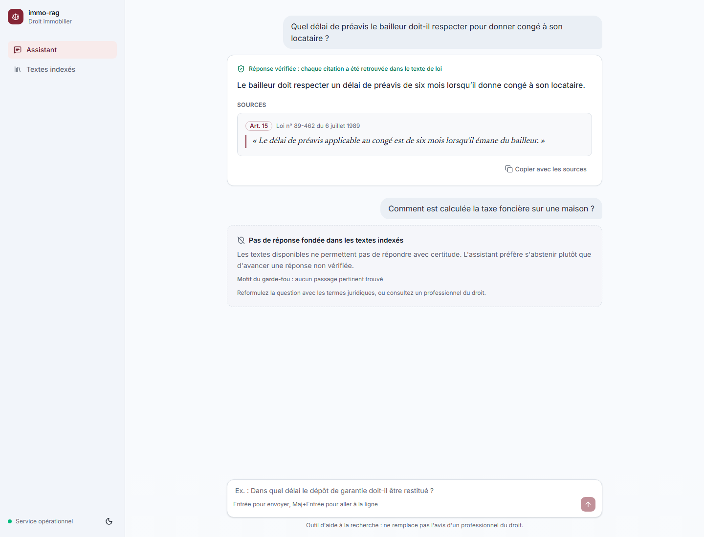

# immo-rag

Assistant de recherche documentaire pour les professionnels de l'immobilier
(agents, gestionnaires, syndics). Il répond aux questions métier — préavis,
dépôt de garantie, copropriété, charges — en **citant le passage exact** du
texte de loi, et **refuse de répondre** quand la base ne fonde pas la réponse.

Dans un domaine réglementé, une réponse inventée coûte plus cher qu'une absence
de réponse : le garde-fou anti-hallucination est le cœur du produit, pas une
option.



## Fonctionnement

```
question
   │
   ├─ recherche hybride ── sens (pgvector, e5-base) ─┐
   │                     └ mots-clés (BM25 français) ┴─ fusion RRF
   ├─ reclassement (cross-encoder BGE-m3, local)
   ├─ GARDE-FOU 1 : meilleur score de reclassement sous le seuil → refus,
   │                 sans appeler le LLM
   ├─ génération de la réponse citée (Groq)
   ├─ GARDE-FOU 2a : chaque citation doit se retrouver dans le texte récupéré
   └─ GARDE-FOU 2b : la réponse est découpée en affirmations ; chacune est
                     confrontée aux articles cités par un modèle NLI local
                     (mDeBERTa, multilingue), le reste tranché par un juge LLM
```

Les deux étages du garde-fou jugent des choses différentes : le premier, la
pertinence de ce qui a été retrouvé ; le second, la fidélité du texte rédigé à
ce qui a été retrouvé. Un LLM peut broder à côté même avec la bonne source sous
les yeux.

Une réponse vraie phrase par phrase peut encore tromper par omission : donner
le plafond majoré de 21 400 € (travaux de rénovation énergétique) sans la règle
générale de 10 700 €. Quand une réponse s'appuie sur une dérogation ou sur un
article de régime particulier (meublé, bail mobilité), le juge LLM relit
l'ensemble des articles récupérés ; s'il recopie mot pour mot la règle omise, la
réponse est rédigée une seconde fois avec elle. Contrôle ciblé : appliqué à
chaque réponse, il épuisait le quota gratuit du juge.

Le découpage suit les unités légales (un morceau = un article, avec son
intitulé de section), pas une fenêtre glissante qui couperait un article en
deux.

## Résultats mesurés

Golden dataset : 50 questions métier avec l'article attendu, 4 questions de
suivi (« Et si le logement est loué meublé ? ») et 4 questions hors corpus qui
doivent être refusées. Corpus complet : 7 894 articles (lois de 1989, 1965,
Hoguet, Code civil, Code général des impôts).

| Recherche (hybride + reclasseur) | Valeur |
|----------------------------------|--------|
| hit@1                            | 70,0 % |
| hit@3                            | 92,0 % |
| hit@5                            | 96,0 % |
| hit@10                           | 100 %  |
| MRR                              | 0,802  |

Questions hors corpus : l'étage 1 (score du reclasseur) en arrête la moitié ;
les autres, proches d'un article réel (durée de validité du DPE), sont
refusées par l'étage 2.

De bout en bout, avec de vrais appels LLM (54 questions, 2026-10-20) : 48
réponses fondées sur 54, et 4 refus sur 4 hors corpus. Parmi les réponses
acceptées, une était trompeuse par omission (plafond majoré seul) : c'est ce
cas que traite le contrôle ci-dessus.

Renvois entre textes : un article cite souvent un autre article au lieu d'en
recopier la règle (« l'article 1724 du code civil est applicable »). Les
articles cités par les meilleurs candidats sont ajoutés à ceux que le
reclasseur note, qui juge ensuite chacun sur son texte.

Chaque brique a été gardée ou écartée sur mesure, pas sur intuition :

| Essai                                       | Effet mesuré              | Décision |
|---------------------------------------------|---------------------------|----------|
| Hybride + reclasseur vs recherche par sens  | hit@5 65 % → 84 %         | gardé    |
| Contextual retrieval (résumé du document)   | hit@5 84 % → 71 %         | écarté   |
| Titre de la loi donné au reclasseur         | MRR 0,60 → 0,66           | gardé    |
| Titre de la loi dans les embeddings         | MRR 0,66 → 0,62           | écarté   |
| Reformulation de requête, HyDE              | question hors corpus au-dessus du seuil | écarté |
| Retrait de la loi ALUR (version JO, non consolidée) | MRR 0,686 → 0,706 | gardé    |
| Questions générées par article (doc2query), BM25 | MRR 0,686 → 0,723   | gardé    |
| Ces questions montrées au reclasseur        | MRR 0,725 → 0,765         | gardé    |
| Fenêtres de 1 000 car. pour les articles longs (dense) | MRR 0,765 → 0,790 | gardé |
| Mêmes fenêtres dans l'index BM25            | MRR 0,790 → 0,740         | écarté   |
| Un vecteur par élément d'énumération        | MRR 0,790 → 0,769         | écarté   |
| Articles cités par les candidats ajoutés au reclasseur | MRR 0,789 → 0,802, hit@10 96 % → 100 % | gardé |
| Reclasseur ONNX sur carte graphique         | ~22 s → ~0,6 s par requête | gardé (option) |

## Stack

100 % gratuite : aucun fournisseur payant, même en option.

- API : FastAPI (Python 3.12)
- Base : PostgreSQL + pgvector ; BM25 (rank-bm25, tokenizer français qui
  préserve les références « L. 111-1 »)
- Modèles locaux : `intfloat/multilingual-e5-base` (embeddings),
  `BAAI/bge-reranker-v2-m3` (reclassement),
  `MoritzLaurer/mDeBERTa-v3-base-mnli-xnli` (NLI)
- LLM : Groq, offre gratuite (`gpt-oss-20b`, juge `gpt-oss-120b`)
- Évaluation : métriques de recherche maison (hit@k, MRR), DeepEval
  (`faithfulness`)
- Observabilité : Langfuse (désactivé sans configuration)
- Interface : React 19, Vite, TypeScript, Tailwind CSS, shadcn/ui, servie par nginx
- Docker, GitHub Actions

Chaque modèle passe par une interface (`get_*_provider`) réglée dans `.env` :
changer de modèle ne touche pas au code du pipeline.

## Lancer le projet

```bash
cp .env.example .env            # renseigner GROQ_API_KEY
docker compose up -d            # interface :8080, API :8000, base :5433
python scripts/ingerer_corpus.py  # indexe data/clean (une fois)
```

`init.sql` ne s'applique qu'à la création de la base. Pour une base créée avant
un changement de schéma (table `fenetres`, 2026-10-16), le réappliquer puis
réingérer (les instructions existantes sont ignorées) :

```bash
docker compose exec -T db psql -U immo -d immo_rag < init.sql
```

Interface : <http://localhost:8080>. Deux pages : l'assistant (question, réponse
avec ses citations vérifiées ou refus motivé) et les textes indexés.

Développement du front avec rechargement à chaud (l'API doit tourner sur :8000) :

```bash
cd frontend && npm install && npm run dev   # http://localhost:5173
```

| Route                     | Rôle                                        |
|---------------------------|---------------------------------------------|
| `GET /health`             | le serveur répond, la base est-elle joignable |
| `POST /query`             | `{"question": "..."}` → réponse citée ou refus motivé |
| `POST /ingest`            | indexe un texte de loi                      |
| `GET /documents`          | textes indexés, nombre de morceaux          |
| `DELETE /documents/{id}`  | retire un texte de la base                  |

## Qualité

```bash
pytest -q                       # tests unitaires (doublures, aucun appel réseau)
ruff check .
python -m eval.ablation --rerank  # comparaison des systèmes de recherche
python -m eval.gate             # contrôle les métriques contre eval/seuils_gate.json
python -m eval.run_eval         # golden de bout en bout (appels Groq réels)
```

La CI (`.github/workflows/ci.yml`) lance le lint et les tests (avec une base
pgvector réelle), puis le gate d'évaluation : une modification qui fait reculer
la recherche sous les planchers fait échouer la CI, même si tous les tests
unitaires passent.

## Limites connues

- Écart de vocabulaire : certaines questions ne retrouvent pas l'article
  attendu (loi Hoguet, révocation du syndic à l'art. 25).
- Le juge LLM tranche mal les régimes particuliers présentés comme la règle
  générale, et son verdict varie selon le modèle (120b ou repli 20b).
- Quotas gratuits de Groq : quelques réponses par minute.
